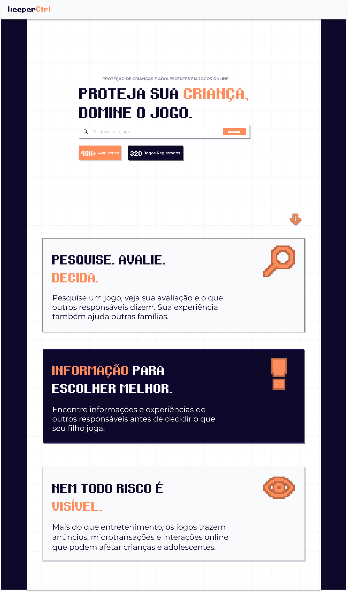
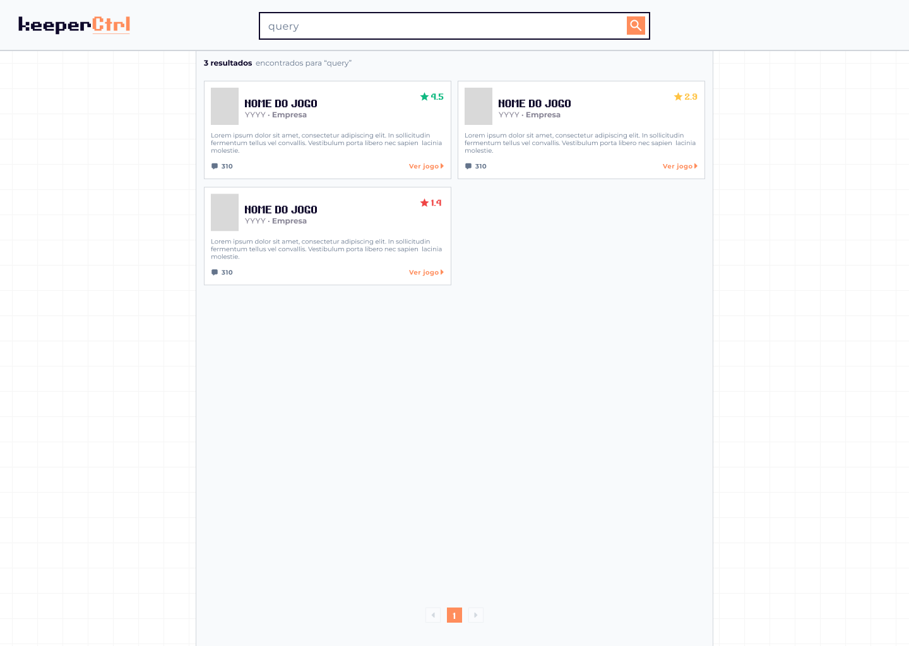
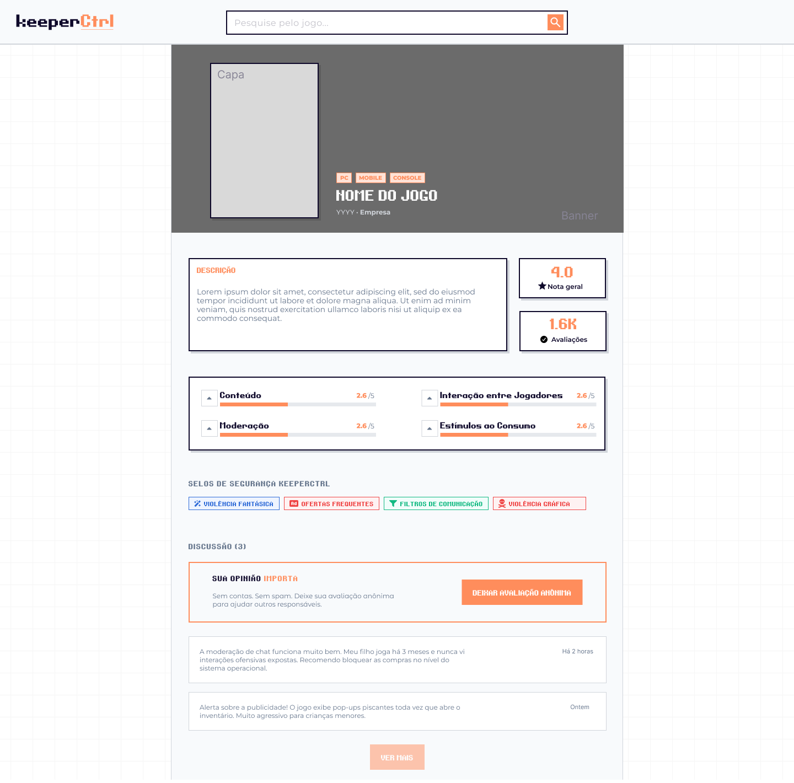
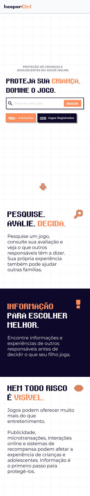
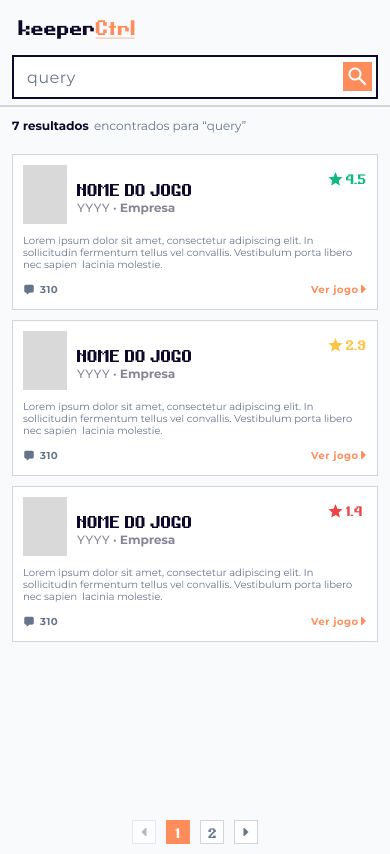
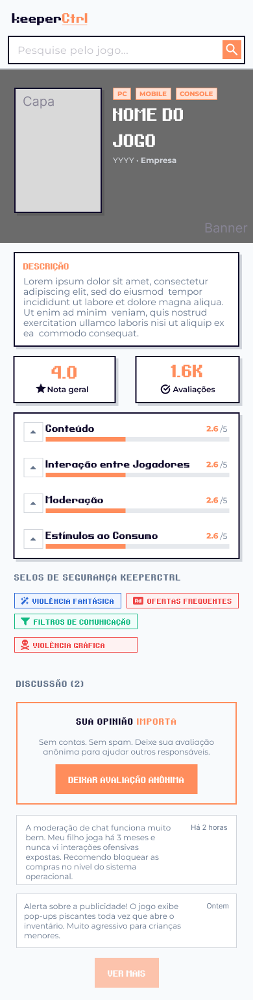

# keeperCtrl

Projeto para a disciplina de Desenvolvimento de Sistemas Web do curso de Engenharia de Computação, PUC-Campinas.

## Descrição

O keeperCtrl é uma plataforma destinada a pais e responsáveis que desejam conhecer melhor os jogos eletrônicos consumidos por crianças e adolescentes. Por meio de avaliações colaborativas e discussões entre usuários, busca fornecer informações sobre possíveis riscos associados a esses jogos, auxiliando os responsáveis a tomar decisões mais conscientes sobre o conteúdo acessado por seus filhos.

O projeto está relacionado aos seguintes Objetivos de Desenvolvimento Sustentável (ODS) da ONU:

- [x] ODS 3 - Saúde e bem-estar
- [x] ODS 9 - Indústria, inovação e infraestrutura
- [x] ODS 16 - Paz, justiça e instituições eficazes

## Como Funciona

A plataforma permite pesquisar jogos e consultar informações fornecidas pela comunidade de usuários.

Cada jogo possui uma página própria, na qual são apresentadas avaliações organizadas em quatro aspectos principais:

- **Conteúdo:** violência, conteúdo sexual, linguagem e temas sensíveis.
- **Interação:** comunicação, contato com desconhecidos, comunidade e competição.
- **Moderação:** denúncias, bloqueios, filtros e controle parental.
- **Estímulos ao consumo:** microtransações, pressão para compras, lootboxes e publicidade.

Os usuários podem atribuir notas aos critérios apresentados, registrar comentários e selecionar selos que representem características relevantes do jogo. As avaliações são utilizadas para calcular pontuações gerais e por categoria, enquanto os selos são exibidos conforme sua recorrência entre os participantes.

## Acesso à Aplicação

[Acessar keeperCtrl](https://lucasngtg.github.io/keeperCtrl/)

## Tecnologias Utilizadas

[![CSS][CSS]][CSS-url]
[![HTML][HTML]][HTML-url]
[![JavaScript][JavaScript]][JavaScript-url]

A aplicação foi desenvolvida utilizando tecnologias nativas da Web, sem a utilização de frameworks ou bibliotecas externas.

## Execução Local

Para executar a aplicação localmente, é necessário utilizar um servidor HTTP.

- **[http-server](https://www.npmjs.com/package/http-server):** servidor HTTP simples, instalável via npm. Após a instalação, execute o seguinte comando na raiz do projeto:

  ```bash
  npx http-server
  ```

- **[Five Server](https://marketplace.visualstudio.com/items?itemName=yandeu.five-server):** extensão para o Visual Studio Code que disponibiliza um servidor local com atualização automática do navegador. Basta instalar a extensão, abrir o projeto no VS Code e iniciar o servidor.

Após iniciar o servidor, acesse o endereço local indicado pela ferramenta no navegador.

## Estrutura do Projeto

| Pasta                   | Conteúdo                      |
| ----------------------- | ----------------------------- |
| /docs                   | Documentação do projeto       |
| /docs/meetings          | Atas de reunião               |
| /docs/report            | Relatórios                    |
| /docs/research          | Pesquisas realizadas          |
| /docs/research/concepts | Conceitos pesquisados         |
| /src                    | Código fonte                  |
| /src/css                | Estilização                   |
| /src/data               | Dados estáticos               |
| /src/fonts              | Fontes                        |
| /src/js                 | Scripts                       |
| /assets                 | Imagens e ícones              |
| /assets/games           | Capas e banners dos jogos     |
| /demo                   | Imagens e vídeos ilustrativos |
| /demo/proto             | Imagens do protótipo          |


## Aplicação em Funcionamento

Página inicial e mecanismo de pesquisa:


Página de jogo e sistema de avaliação:


## Protótipo

[![Figma][Figma]][Figma-url] Protótipo desenvolvido usando Figma.





| Main Page - Mobile                                      | Search Page - Mobile                                        | Game Page - Mobile                                      |
| ------------------------------------------------------- | ----------------------------------------------------------- | ------------------------------------------------------- |
|  |  |  |

## Equipe

- Cauan Kazuhiro Matsuse — Controle de Relatórios
- Davi Vieira Miranda — Gerenciamento do Jira
- Lucas Nogami Tung — Gerenciamento do GitHub
- Phabio Diniz Rezende — Identidade Visual

## Status do Projeto

Finalizado.

[HTML]: https://img.shields.io/badge/HTML-E34F26?style=for-the-badge&logo=html5&logoColor=FFFFFF
[HTML-url]: https://developer.mozilla.org/en-US/docs/Web/HTML
[CSS]: https://img.shields.io/badge/CSS-663399?style=for-the-badge&logo=css&logoColor=FFFFFF
[CSS-url]: https://developer.mozilla.org/en-US/docs/Web/CSS
[JavaScript]: https://img.shields.io/badge/JavaScript-F7DF1E?style=for-the-badge&logo=javascript&logoColor=000000
[JavaScript-url]: https://developer.mozilla.org/en-US/docs/Web/JavaScript
[Figma]: https://img.shields.io/badge/Figma-F24E1E?style=for-the-badge&logo=figma&logoColor=white
[Figma-url]: https://www.figma.com/
